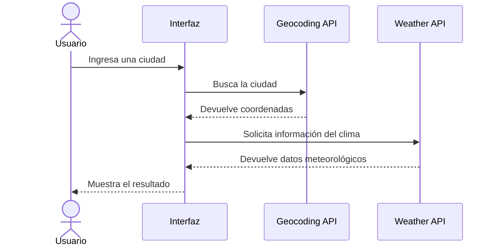

# Evaluación 03 - JavaScript avanzado

Proyecto desarrollado para la evaluación de JavaScript avanzado de Tecsup. Se trabajan conceptos de manipulación del DOM, módulos ES6, programación asíncrona y consumo de APIs.

## Estado del proyecto


**GitHub Pages:** :(https://raylaberry-code.github.io/evaluacion03-js/)

## Índice

- [Estructura del proyecto](#estructura-del-proyecto)
- [Pregunta 1: Manipulación del DOM](#pregunta-1-manipulación-del-dom)
- [Pregunta 2: Módulos ES6](#pregunta-2-módulos-es6)
- [Pregunta 3: Consumo de API](#pregunta-3-consumo-de-api)
- [Registro de uso de IA](#registro-de-uso-de-ia)
- [Conclusión](#conclusión)
- [Checklist de entregables](#checklist-de-entregables)
- [Cómo ejecutar el proyecto](#cómo-ejecutar-el-proyecto)

## Estructura del proyecto

```text
evaluacion03-js/
│
├── p1-dom/
│   ├── img1/
│   ├── app.js
│   ├── index.html
│   └── styles.css
│
├── p2-modulos/
│   ├── img2/
│   ├── index.html
│   ├── main.js
│   ├── pedidos.js
│   ├── styles.css
│   └── ui.js
│
├── p3-api/
│   ├── img3/
│   ├── app.js
│   ├── index.html
│   └── styles.css
│
└── README.md
```

## Pregunta 1: Manipulación del DOM

En esta pregunta se desarrolló una interfaz para administrar productos utilizando JavaScript y el DOM.

Se implementaron las siguientes funciones:

- Agregar productos.
- Validar los datos ingresados.
- Mostrar y filtrar productos.
- Cambiar el estado de los productos.
- Eliminar productos.
- Calcular el total de los productos.

### Fragmento de código

Se utilizó `createElement()` y `textContent` para mostrar los datos de forma segura.

```js
function renderizarProductos() {
    listaProductos.innerHTML = "";

    productos.forEach(producto => {
        const elemento = document.createElement("div");

        elemento.textContent =
            `${producto.nombre} - S/ ${producto.precio}`;

        listaProductos.appendChild(elemento);
    });
}
```

### Seguridad

Se utilizó `textContent` para mostrar los datos ingresados como texto y evitar que se interpreten como código HTML.

También se trabajó con eventos para controlar las acciones realizadas en la interfaz.

### Evidencias

Las capturas se encuentran en `p1-dom/img1/`.

| Captura | Descripción |
|---|---|
| 01-productos.png | Productos registrados |
| 02-entregado.png | Cambio de estado |
| 03-eliminado.png | Eliminación de producto |
| 04-validaciones.png | Validaciones del formulario |
| 05-seguridad.png | Prueba de seguridad |

## Pregunta 2: Módulos ES6

En esta pregunta se organizó el código utilizando módulos de JavaScript para separar las responsabilidades.

Se crearon tres archivos principales:

- `pedidos.js`: contiene la clase Pedido, los datos y las funciones de cálculo.
- `ui.js`: se encarga de mostrar la información en la interfaz.
- `main.js`: conecta los módulos y ejecuta el programa.

### Fragmento de código

Se utilizó una clase para representar los pedidos:

```js
export class Pedido {
    constructor(nombre, precio, cantidad) {
        this.nombre = nombre;
        this.precio = precio;
        this.cantidad = cantidad;
    }

    subtotal() {
        return this.precio * this.cantidad;
    }
}
```

Para calcular el total se utilizó `reduce()`:

```js
export function calcularTotal(lista) {
    return lista.reduce(
        (total, pedido) =>
            total + pedido.precio * pedido.cantidad,
        0
    );
}
```

### Comparación entre || y ??

Se comprobó que `||` reemplaza el valor `0` por otro valor, mientras que `??` solamente reemplaza valores `null` o `undefined`.

| Expresión | Resultado |
|---|---|
| `0 || 1` | 1 |
| `0 ?? 1` | 0 |

Por eso se utilizó `??` para conservar correctamente la cantidad cero.

### Cálculo del IGV

Con los pedidos de prueba:

- Café: S/ 6 × 2 = S/ 12
- Croissant: S/ 4.50 × 0 = S/ 0
- Jugo: S/ 8 × 1 = S/ 8

**Base:** S/ 20.00  
**IGV (18%):** S/ 3.60  
**Total:** S/ 23.60

### Evidencias

Las capturas se encuentran en `p2-modulos/img2/`.

| Captura | Descripción |
|---|---|
| 01-resumen.png | Resumen de pedidos |
| 02-nullish-vs-or.png | Comparación entre operadores |
| 03-modulos-conectados.png | Comprobación de los módulos |
| 04-error-file.png | Error al abrir los módulos mediante file:// (si se guardó esta captura) |

### Problema al abrir los módulos

Al abrir el archivo HTML directamente mediante `file://`, el navegador bloqueó la carga de los módulos JavaScript por una política CORS.

Se solucionó utilizando Live Server, que permite ejecutar el proyecto mediante una dirección HTTP local.

## Pregunta 3: Consumo de API

En esta pregunta se desarrolló una aplicación para consultar información del clima utilizando la API de Open-Meteo.

Se trabajó con:

- `fetch()` para realizar solicitudes.
- `async/await` para manejar operaciones asíncronas.
- `try/catch/finally` para controlar errores.
- `Promise.all()` para ejecutar consultas en paralelo.
- `Promise.allSettled()` para revisar los resultados de varias consultas.
- `performance.now()` para medir los tiempos de ejecución.

### APIs utilizadas

**Geocoding API**

Permite buscar una ciudad y obtener sus coordenadas.

Endpoint:

```text
https://geocoding-api.open-meteo.com/v1/search
```

Parámetros utilizados:

| Parámetro | Función |
|---|---|
| name | Nombre de la ciudad |
| count | Cantidad de resultados |
| language | Idioma de los resultados |
| format | Formato de respuesta |

**Weather Forecast API**

Permite consultar el clima utilizando las coordenadas de la ciudad.

Endpoint:

```text
https://api.open-meteo.com/v1/forecast
```

Parámetros utilizados:

| Parámetro | Función |
|---|---|
| latitude | Latitud |
| longitude | Longitud |
| current | Variables meteorológicas actuales |
| temperature_2m | Temperatura |
| relative_humidity_2m | Humedad relativa |
| wind_speed_10m | Velocidad del viento |

Documentación oficial: [Open-Meteo API](https://open-meteo.com/en/docs)

### Fragmento de código

Se utilizó `async/await` para realizar las consultas:

```js
async function consultarClima(nombre) {
    try {
        const ciudad = await buscarCiudad(nombre);
        const clima = await obtenerClima(ciudad);

        mostrarClima(clima);
    } catch (error) {
        mostrarError(error.message);
    }
}
```

### Comparación de ejecución

Se comparó la ejecución secuencial con la ejecución en paralelo.

| Método | Funcionamiento |
|---|---|
| Secuencial | Espera a que termine una consulta antes de iniciar la siguiente |
| Paralelo | Ejecuta varias consultas al mismo tiempo |

En una de las pruebas, la ejecución secuencial demoró aproximadamente 2641.50 ms y la paralela 1158.20 ms.

Los tiempos pueden variar según la conexión y la respuesta de la API.

### Promise.all y Promise.allSettled

También se realizaron pruebas con ciudades válidas y una ciudad inexistente.

- `Promise.all()` rechaza la operación cuando una de las promesas falla.
- `Promise.allSettled()` permite revisar el resultado de cada promesa, incluso si alguna falla.

### Diagrama del funcionamiento



### Evidencias

Las capturas se encuentran en `p3-api/img3/`.

| Captura | Descripción |
|---|---|
| 01-clima-lima.png | Consulta del clima de Lima |
| 02-secuencial.png | Ejecución secuencial |
| 03-paralelo.png | Ejecución en paralelo |
| 04-mediciones.png | Comparación de tiempos |
| 05-promise-all.png | Prueba con Promise.all |
| 06-promise-allsettled.png | Prueba con Promise.allSettled |
| 07-ciudad-invalida.png | Búsqueda de ciudad inexistente |
| 08-sin-internet.png | Prueba sin conexión a Internet |

## Registro de uso de IA

Se utilizó inteligencia artificial como apoyo para desarrollar, revisar y comprender algunas partes del proyecto. Las propuestas fueron comprobadas mediante pruebas en el navegador y revisión de los resultados.

| N.º | Pregunta | IA usada | Qué propuso la IA | Decisión | Por qué |
|---|---|---|---|---|---|
| 1 | P1 | ChatGPT | Utilizar métodos del DOM para mostrar los productos. | Aceptó | Se comprobó que los productos se mostraban correctamente. |
| 2 | P1 | ChatGPT | Utilizar `textContent` para mostrar datos ingresados. | Aceptó | Se probó con texto HTML y se verificó que no se ejecutara como código. |
| 3 | P2 | ChatGPT | Separar el programa en módulos ES6. | Aceptó | Se comprobó que los módulos se conectaban correctamente. |
| 4 | P2 | ChatGPT | Utilizar `??` en lugar de `||` para conservar valores cero. | Aceptó | La prueba mostró que `0 ?? 1` devuelve 0, mientras que `0 || 1` devuelve 1. |
| 5 | P3 | ChatGPT | Utilizar `async/await` y `fetch()` para consultar las APIs. | Aceptó | Se verificaron los resultados al consultar ciudades. |
| 6 | P3 | ChatGPT | Utilizar `Promise.all()` y `Promise.allSettled()` para comparar consultas. | Aceptó | Se comprobó el comportamiento con consultas válidas y una ciudad inexistente. |

## Conclusión

Durante esta evaluación pude practicar diferentes conceptos de JavaScript y comprender mejor cómo se aplican en un proyecto. En la primera pregunta trabajé con el DOM, los eventos y las validaciones para administrar productos. También comprobé la importancia de utilizar `textContent` al mostrar datos ingresados por el usuario.

En la segunda pregunta aprendí a separar el código mediante módulos ES6 y a utilizar clases y funciones para organizar mejor la información. Una de las decisiones importantes fue utilizar el operador `??` en lugar de `||`, porque necesitaba conservar el valor cero en la cantidad de los pedidos. Comprobé esta diferencia mediante pruebas en la consola.

En la tercera pregunta trabajé con APIs y programación asíncrona. Pude observar la diferencia entre ejecutar consultas de manera secuencial y en paralelo. También comprobé cómo responden `Promise.all()` y `Promise.allSettled()` cuando una consulta falla.

La inteligencia artificial me ayudó a comprender conceptos, revisar errores y proponer soluciones. Sin embargo, también fue necesario comprobar las propuestas ejecutando el código y revisando los resultados. Esto me permitió identificar que no basta con copiar una solución, sino que debo entender qué hace y verificar si realmente funciona.

Considero que esta evaluación me ayudó a mejorar mi comprensión de JavaScript y a organizar mejor mis proyectos.

## Checklist de entregables

- [x] Pregunta 1: Manipulación del DOM.
- [x] Pregunta 2: Módulos ES6.
- [x] Pregunta 3: Consumo de API.
- [x] Pruebas de validación y seguridad.
- [x] Pruebas de operadores `||` y `??`.
- [x] Pruebas de ejecución secuencial y paralela.
- [x] Pruebas con `Promise.all()` y `Promise.allSettled()`.
- [x] Capturas de evidencias.
- [x] Registro de uso de inteligencia artificial.
- [x] Conclusión.
- [ ] Publicar el repositorio en GitHub.
- [ ] Publicar el proyecto en GitHub Pages.
- [ ] Completar el enlace de GitHub Pages en este README.
- [ ] Realizar al menos 6 commits progresivos.

## Cómo ejecutar el proyecto

1. Descargar o clonar el repositorio.
2. Abrir la carpeta `evaluacion03-js` en Visual Studio Code.
3. Abrir la carpeta de la pregunta que se desea ejecutar.
4. Utilizar Live Server para abrir el archivo `index.html`.
5. En la pregunta 3, mantener conexión a Internet para consultar la API.

**Nota:** Para la pregunta 2 es necesario utilizar un servidor local como Live Server para cargar correctamente los módulos ES6.

## Tecnologías utilizadas

- HTML5
- CSS3
- JavaScript ES6+
- Visual Studio Code
- Open-Meteo API
- Git y GitHub